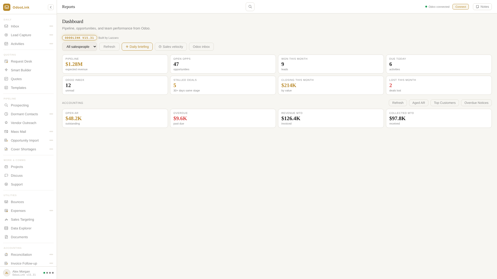
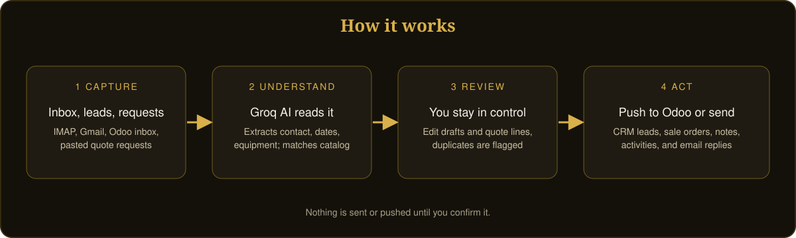
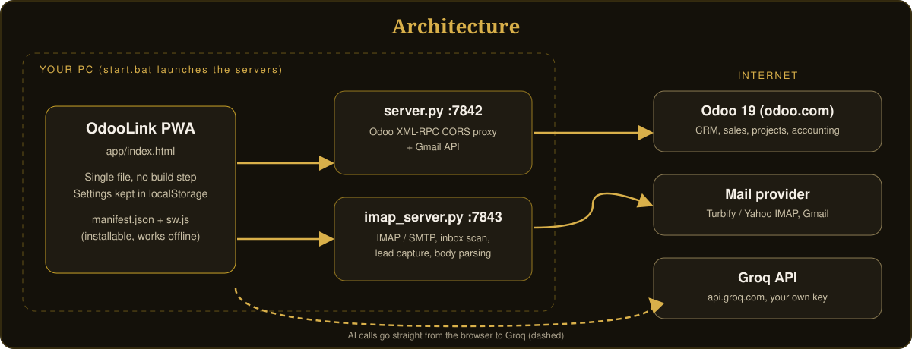

<p align="center"></p>

# OdooLink

**AI-powered sales operations command center for Odoo 19.** One screen for your IMAP and Gmail inboxes, your Odoo CRM, AI-drafted replies, rental quotes, vendor outreach and more. Built by [LAZLAB Creations](https://johnlaz.github.io/).



*Screenshots use simulated data.*

---

## Live URLs

| | |
|---|---|
| Landing page | https://johnlaz.github.io/odoolink/ |
| App | https://johnlaz.github.io/odoolink/app/ |

The app is an installable PWA. It is most useful when run next to its two small local servers (see [Quick start](#quick-start)).

---

## What it does

- **Inbox:** Turbify/IMAP, Odoo and Gmail in one view. AI reply drafts, log to Odoo, bounce detection.
- **Lead Capture:** scan the inbox for leads, AI extracts the contact, push to Odoo CRM. Duplicate check and forwarded-email detection.
- **Activities:** due-today list, AI follow-up drafts, send via IMAP with auto-log.
- **Quotes and Smart Builder:** paste any request, AI extracts contact and equipment, fuzzy-matches your Odoo catalog, pushes a rental order.
- **Request Desk:** AI drafts a response with clarifying questions for vague requests.
- **Projects:** Odoo project and task browser, quick add, task edit with AI rewrite, To Do list, AI brainstorm chat.
- **Pipeline tools:** dormant contacts, vendor outreach, mass mail, opportunity import, bounce manager.
- **Accounting:** reconciliation, invoice follow-up, expenses and vendor bills.
- **Dashboard:** CRM pipeline cards, accounting summary, AI daily briefing.
- **Documents:** local library for W9s, COIs and contracts, attachable to Odoo contacts.

<p align="center"></p>

---

## Quick start

**Requirements:** Windows, Python 3, an Odoo 19 API key, and a free [Groq API key](https://console.groq.com/keys).

1. Keep `index.html`, `server.py`, `imap_server.py` and `start.bat` together in one folder (use the gear menu > **Download Server Files** > **Full app folder (.zip)** to get them).
2. Double-click `start.bat`. It starts both servers and opens the app in Chrome.
3. Open **Settings** and enter your Odoo URL, database, username, API key and Groq key.

| File | Port | Purpose |
|------|------|---------|
| `app/server.py` | 7842 | Odoo XML-RPC CORS proxy and Gmail API |
| `app/imap_server.py` | 7843 | IMAP/SMTP, inbox scan, lead capture, body parsing |

<p align="center"></p>

---

## Repo layout

```
/index.html          landing page
/README.md
/docs/               README visuals (SVG)
/app/index.html      the app (single file)
/app/manifest.json, sw.js
/app/icon-192.png, icon-512.png
/app/shot-*.png      install screenshots (simulated data)
/app/server.py, imap_server.py, start.bat   local servers and launcher
```

---

## AI and model setup

OdooLink uses **Groq** only. Your key is entered in Settings and kept in your browser.

- The model picker ships with three options and a default of `qwen/qwen3.8-27b`.
- Saving a `gsk_` key fetches your current model list from Groq. **Refresh models** does the same on demand.
- Refreshing only **adds** models. Your existing options and your saved selection are never changed. If your saved model is missing from Groq's list it is kept and flagged.
- Newly listed models are untested here. Some may not accept the `reasoning_effort` setting the app sends, in which case you will see an error and can pick another model.

---

## Data and privacy

- Settings, credentials, templates, notes and the document library live in your browser's `localStorage` on your device.
- **Odoo calls:** in *Local Server* mode they go through `server.py` on your PC. In *Proxy* mode they go through public third-party CORS proxies, which see the request. Prefer Local Server mode.
- **AI calls:** email text you ask the AI to read is sent to Groq with your key.
- Both servers listen on `localhost` only.
- `credentials.json` and `token.json` (Gmail authorization) are in `.gitignore`. Never commit them.

---

## Deploy and update

The site is static and served by GitHub Pages from the repo root.

1. Edit `app/index.html`.
2. Run `scripts/bump-version.sh <new version>` (e.g. `15.72`). It updates the meta tag in `app/index.html`, `VERSION` in `app/sw.js` and the landing page badge together; in-app labels read the meta tag. Then add a changelog row.
3. Commit and push. HTML is fetched network-first, so a normal reload picks it up. Open installs show a small **Reload** prompt when a new version takes over.

If you change `server.py`, `imap_server.py` or `start.bat`, also refresh the embedded copies that Settings falls back to when the app is opened from `file://`.

---

## Changelog

| Version | Highlights |
|---------|-----------|
| **v15.75** | HTTP 502 fix everywhere: every Odoo read now retries gateway errors (502/503/504) up to twice (writes are never retried); Pipeline Health loads one query at a time with activities in small pages. |
| **v15.74** | Data Health scan reads Odoo in small pages and retries gateway errors (fixes HTTP 502 on large accounts). |
| **v15.73** | New **Data Health** tab (Utilities): 🔍 Scan Odoo reports test and duplicate quotes, open quotes with no opportunity, stacked follow-up text, overdue activities, duplicate/bad/placeholder contacts, people that look like companies, and unreachable contacts, plus tiles showing whether new quotes and leads are being linked and sourced. One-sheet-per-check export; safe fixes (clean text, archive, mark as company). |
| **v15.72** | Version stamps unified: app meta tag, service worker, landing page and every in-app label (Help, About) now come from one number; `scripts/bump-version.sh` updates them together. |
| **v15.71** | Inbox: 📥 CRM button turns an email into a lead. Notes now post as real formatting (Odoo escapes plain strings, so they are written back as HTML and verified). Help gains a "Where do I find…?" guide; search keywords broadened. |
| **v15.70** | Quotes link to an opportunity (editable default) with payment terms; activities default to the opportunity; new Pipeline Health tab; to-dos for overdue invoices; leads get an OdooLink source. |
| **v15.69** | Activity type list limited to general types. |
| **v15.68** | Schedule an activity to several people at once (one activity each). |
| **v15.67** | Cleaner logged notes, verified activities assigned to you by default, note/activity destination picker; composer popups close only with X. |
| **v15.56** | Sales Reporting: **Σ Tax totals** button shows total tax per approved name (FL Sales Tax vs NW Sales Tax and Services), any unapproved names, the Odoo tax-engine amount (invoices) and an all-tax total for the rows listed; included in exports. |
| **v15.55** | Tax-names dialog wording now covers invoices as well as orders. |
| **v15.54** | Sales Reporting: new Source switch — run the report on **Sales orders** (as before) or **Customer invoices** (account.move; invoice date, status incl. Paid/Partial/Unpaid, credit notes negative, tax-named lines plus Odoo's own tax amount). Default approved tax names are now “FL Sales Tax” and “NW Sales Tax and Services” (old NW Tax / Local Tax defaults retired). Approved tax names and other report settings are now included in the credentials export/import. |
| **v15.53** | Email Studio: ✨ Write with AI (Groq) rewrites the ticked parts of the email from a short campaign brief and suggests 3 subject lines, with one-click undo. Fix: sidebar items not listed in a section (Email Studio) no longer jump to the top of the sidebar once a saved section order exists — unlisted items now travel with their section. |
| **v15.52** | **Email Studio** (Pipeline, under Mass Mail): the TRS trade-show email as an editable master — change any text, link or button, upload/replace pictures (auto-cropped and shrunk), show/hide sections, add/reorder feature cards, Dark/Light theme and colour overrides; live desktop/mobile preview; save as reusable templates (IndexedDB) with export/import and draft autosave; Copy for Outlook, Copy HTML, download .html. |
| **v15.51** | Styled HTML export fits wide screens without sideways scrolling and gains a ⚙ Columns menu / × on headers to hide columns. |
| **v15.50** | Styled HTML export now colour-coded like the app: severity-tinted overdue rows and day badges, status pills (Exact / Net of fees / Never sent / Sent…), cyan money and invoice refs, coloured section headers and summary tiles. |
| **v15.49** | Export / Print menu (every tab) gains **Styled HTML** — a self-contained, shareable page with a branded header, totals, per-table filter and click-to-sort, dark-mode support and clean printing. |
| **v15.48** | Needs Coding: new **Guess** tier suggests an account from your chart of accounts (keyword match on airline, tolls, software, meals, etc.) when there's no history; history loader no longer depends on the reconciled flag; a diagnostics banner explains how much history was read; optional ✨ Suggest with AI (Groq) for Review/Guess rows. Guesses are never auto-ticked. |
| **v15.47** | Reconciliation → Needs Coding rebuilt as a sortable, searchable table. Suggests a partner and account for every unreconciled line from your reconciled history, with Confident / Likely / Review confidence and a reason on each row; flags lines where Odoo's partner looks wrong; includes lines that already have a partner but aren't reconciled; Accept all Confident saves the sure ones in one click. Rules now apply automatically and sit in a collapsible panel. |
| v15.46 | Invoice Follow-up: sort menu, and payment matching that checks unreconciled bank deposits against open invoices (exact, net of Stripe card/ACH fees, or one deposit covering several invoices) with a deposits list and match calculator. New Export button on every tab: clean Print / Save as PDF plus Excel and CSV. Sidebar: Accounting now sits ahead of Reports even with an older saved sidebar order. |
| **v15.33** | Rental quote replies (Inbox draft and Request Desk) now read the customer's email, repeat back the details already given, and ask only for what is missing, following the Total Rental Solutions intake list. |
| v15.31 | Renamed to OdooLink. Light and gold is the default theme for new installs. Service worker now network-first for HTML with an update prompt. Square, maskable-safe icons, manifest `id`, screenshots and working shortcuts. Groq model refresh added to the existing picker. Settings downloads are current, plus a full app folder zip. Version stamp in the sidebar. README and docs rewritten. |
| v15.30 and earlier | See git history. Highlights: Reconciliation and Invoice Follow-up, Opportunity Import, Mass Mail, Sales Reporting with commission, Expenses rebuilt for Odoo 19, Document Library, Smart Builder, Projects. |

---

&copy; 2026 LAZLAB Creations. All Rights Reserved. &middot; lazlab.io@gmail.com
